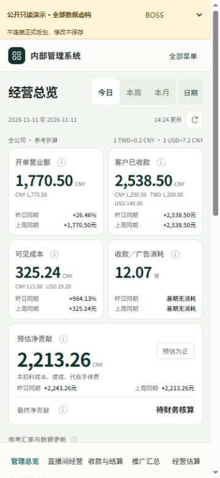

# 经营总览 P0：独立演示指标契约

状态：2026-11-11 用户确认仅整改独立演示站；可见成本排除料成本、提成、代收手续费。正式数据库、安装副本、财务填报流程不变。本文是 P0 的接口交接点，后续展示不得另算一套总额。

## 范围及负责人

本阶段由 Codex 负责指标计算及展示。仅 `demo` 构建模式启用新首页，标准 production 构建仍使用原首页。`GET /api/demo/boss-overview` 只由公开演示的只读拦截器提供，非正式后端路由；其他角色和写请求拒绝，不接数据库。

## 请求与返回

请求：`preset=day|week|month`，或同时传 ISO `from`、`to`。时区 Asia/Shanghai。未来日期、逆序、缺少一端、超过 366 天均拒绝。

返回 `version: boss-overview-p0/v1`，包括：

- `period`：日期及截至时刻；全公司范围。首页筛选与所有明细共用此区间。
- `metrics.{turnover,receipts,visibleCost,estimatedContribution,roi}`：`value`（两位十进制字符串或 null）、`unit`、`status`、`nativeTotals`、`definition`、`source`、`comparisons[]`。
- `finalContribution`：三项财务扣除均已覆盖每个统计日才计算；明确录入 0 有效，缺项或缺日为 `pending_finance`，绝不使用预估值填充。
- `ledger[]`：同一输入明细，含原币、参考折算金额、汇率、生效日、纳入/排除理由。卡片明细直接展示此数组。
- `fx`：按业务发生日查找已生效且未过期的汇率，显示 `1 原币 = x CNY`；缺汇率时相关合计为 null，已知小计不冒充完整合计。CNY 恒为 1。
- `sources[]`：各数据源更新时间；`paidPerformance` 保留已有财务核定业绩，独立于收款、净贡献。
- `target`：可选月营业额目标；缺失时不展示。配置为演示内置只读对象，不新增后台设置。

## 定义

| 指标 | 定义 |
| --- | --- |
| 开单营业额 | 原开单卡料价＋代购费，排除跑单与历史退款标记源单，按原开单日重算；不含追加收费 |
| 客户已收款 | 有效客户付款，按付款日和原币汇总后参考折算；不等于公司实际到账，也不等于财务核定已付款业绩 |
| 可见成本 | 设计、加工、配件、证书、包装、运输等明确分类费用＋实际广告消耗，按发生日；商品/料成本（含配货采购）、提成、代收手续费排除；其他未分类费用存在时暂不算完整合计 |
| 预估净贡献 | 客户已收款参考折算－可见成本；必须显示未扣料成本、提成、代收手续费；不称公司净利润 |
| 最终净贡献 | 预估净贡献－财务专项录入的料成本、提成、代收手续费；不从费用账自动补财务核算 |
| 收款／广告消耗（ROI） | 已收款参考折算÷广告消耗参考折算；可见成本不作分母，零消耗显示无广告消耗，不显示无穷大；不是利润率或因果归因结论 |

参考折算按每笔四舍五入到分后相加，使用整数计算。示例汇率（TWD 0.200000、USD 7.200000）纯属虚构，不推算实际结汇到账。

对比：日视图显示昨日同期、上周同期；周视图显示上周同期；月视图显示上月同期，月末按实际天数截断。未结束期间以同一当地时刻截断两端；自定义区间比较前一个等长区间。历史当前状态重算，不冒充历史快照。基期 0、不完整基期和汇率缺失不计算增长率。预估净贡献跨盈亏仅显示金额差，不用负基期百分比误导。

## 已知对账值（默认今日演示）

- 开单：1290.50＋480.00＝1770.50 CNY；退款标记 180.00 排除，追加收费 300.00 另列。
- 客户收款：1290.50 CNY＋1200.00 TWD×0.2＋140.00 USD×7.2＝2538.50 CNY。
- 原费用 1415.00 CNY，排除商品成本 1300.00 后，可见业务费用 115.00 CNY。
- 广告 29.20 USD×7.2＝210.24 CNY；可见成本 325.24 CNY。
- 预估净贡献 2538.50－325.24＝2213.26 CNY；今日未录财务专项扣除，最终净贡献待财务核算。
- 收款／广告消耗＝2538.50÷210.24＝12.07 倍。
- 财务核定已付款业绩仍为 1290.50 CNY，与上述已收款分开。

## 边界与后续

P1 资金账龄/在制订单/漏斗，P2 归因对比表，P3 预警/复购/默认月视图不在本提交。不上线审核流程，不把主播写成人设，不强制补造历史来源人设，不用日累计替换缺报历史的月累计快照。财务扣除演示采用日级对象只是契约提案，真实录入粒度及格式仍待财务复核。

验收记录及截图放 `artifacts/boss-overview-p0/`（忽略的本地交付物），阶段完成后在此补充结果。

## P0 自测与验收（2026-11-11）

- 独立指标及只读演示测试 28 项通过；前端回归 69 项通过，共 97 项。
- 演示构建通过；标准 production 构建也通过，仍产出原 `index-CycT6mU3.js` / `index-BUGfim2x.css`，未启用新首页。没有修改正式后端、迁移或 Windows 安装副本。
- 浏览器实际验证 375×812、1440×900、3440×1440，均无横向溢出；375px 顶部五项指标及最终核算状态最下沿约 722px，底部导航从 751px 起，不遮挡指标。
- 验证月视图营业额 3170.50、可见成本 355.24、预估净贡献 2183.26；自定义昨日预估 -30.00，财务录入扣除 600＋70＋8 后最终 -708.00；零广告消耗不显示无穷大。
- 验证费用排除、参考汇率及生效日、ⓘ 手机说明、日期筛选、明细进入及返回；未恢复审核流程。
- 本阶段保留历史客户收款归类状态，售后收款无明确分类数据时不单设空卡。资金区与漏斗等待 P1。

构建命令：`npm run build -w frontend -- --mode demo --outDir dist-demo`，然后 `node scripts/package-role-demo.cjs --boss-p0`。发布包仅含静态资源及虚构只读指标服务。

发布结果：独立演示站 `https://demo.nanzhaoarts.com/?role=boss` 已更新至 Cloudflare 静态部署 `100a7d13`（100% 就绪）。8 份公开 HTML/JS/CSS/SVG 资源 HTTP200 且 SHA256 与验收包一致；另含 `_headers` 配置。线上375px再次核验五项数值为1770.50／2538.50／325.24／12.07／2213.26，最终状态为待财务核算，无横向溢出。

Windows 的 ZIP 打包需使用 `/` 作为条目路径分隔符；发布前确认上传界面显示 `assets` 文件夹，而非含反斜杠的平铺文件名。本次已按规范目录打包并在发布后核对所有资源。
