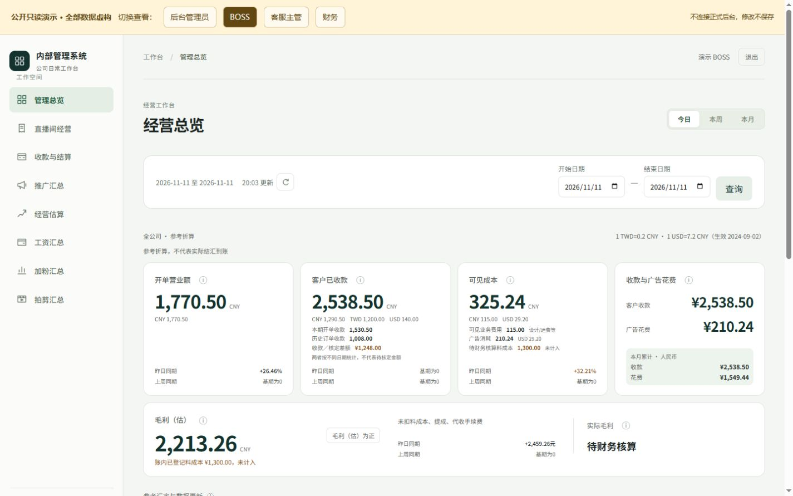
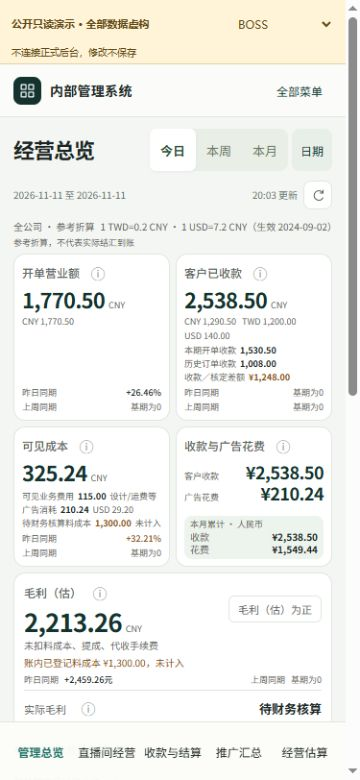

# 经营总览 P0：独立演示指标契约

状态：2026-11-11 用户确认仅整改独立演示站；可见成本排除料成本、提成、代收手续费。正式数据库、安装副本、财务填报流程不变。本文是 P0 的接口交接点，后续展示不得另算一套总额。

## 范围及负责人

本阶段由 Codex 负责指标计算及展示。仅 `demo` 构建模式启用新首页，标准 production 构建仍使用原首页。`GET /api/demo/boss-overview` 只由公开演示的只读拦截器提供，非正式后端路由；其他角色和写请求拒绝，不接数据库。

## 请求与返回

请求：`preset=day|week|month`，或同时传 ISO `from`、`to`。时区 Asia/Shanghai。未来日期、逆序、缺少一端、超过 366 天均拒绝。

返回 `version: boss-overview-p0/v1`，包括：

- `period`：日期及截至时刻；全公司范围。首页筛选与所有明细共用此区间。
- `metrics.{turnover,receipts,visibleCost,estimatedContribution,roi}`：`value`（两位十进制字符串或 null）、`unit`、`status`、`nativeTotals`、`definition`、`source`、`comparisons[]`。
- `finalContribution`：三项财务扣除均已覆盖每个统计日才计算；明确录入 0 有效，缺项或缺日为 `pending_finance`，绝不使用毛利（估）填充。
- `ledger[]`：同一输入明细，含原币、参考折算金额、汇率、生效日、纳入/排除理由。卡片明细直接展示此数组。
- `fx`：按业务发生日查找已生效且未过期的汇率，显示 `1 原币 = x CNY`；缺汇率时相关合计为 null，已知小计不冒充完整合计。CNY 恒为 1。
- `sources[]`：各数据源更新时间；`paidPerformance` 保留已有财务核定业绩，独立于收款、毛利（估）与实际毛利。
- `target`：可选月营业额目标；缺失时不展示。配置为演示内置只读对象，不新增后台设置。

## 定义

| 指标 | 定义 |
| --- | --- |
| 开单营业额 | 原开单卡料价＋代购费，排除跑单与历史退款标记源单，按原开单日重算；不含追加收费 |
| 客户已收款 | 有效客户付款，按付款日和原币汇总后参考折算；不等于公司实际到账，也不等于财务核定已付款业绩 |
| 可见成本 | 设计、加工、配件、证书、包装、运输等明确分类费用＋实际广告消耗，按发生日；商品/料成本（含配货采购）、提成、代收手续费排除；其他未分类费用存在时暂不算完整合计 |
| 毛利（估） | 客户已收款参考折算－可见成本；必须显示未扣料成本、提成、代收手续费；毛利（估）不是公司净利润。接口字段名仍为 `estimatedContribution` |
| 实际毛利 | 毛利（估）－财务专项录入的料成本、提成、代收手续费；不从费用账自动补财务核算；缺项或缺日为待财务核算，不以毛利（估）代替。接口字段名仍为 `finalContribution` |
| 收款／广告消耗（ROI） | 已收款参考折算÷广告消耗参考折算；可见成本不作分母，零消耗显示无广告消耗，不显示无穷大；不是利润率或因果归因结论 |

参考折算按每笔四舍五入到分后相加，使用整数计算。示例汇率（TWD 0.200000、USD 7.200000）纯属虚构，不推算实际结汇到账。

对比：日视图显示昨日同期、上周同期；周视图显示上周同期；月视图显示上月同期，月末按实际天数截断。未结束期间以同一当地时刻截断两端；自定义区间比较前一个等长区间。历史当前状态重算，不冒充历史快照。基期 0、不完整基期和汇率缺失不计算增长率。毛利（估）跨盈亏仅显示金额差，不用负基期百分比误导。

## 已知对账值（默认今日演示）

- 开单：1290.50＋480.00＝1770.50 CNY；退款标记 180.00 排除，追加收费 300.00 另列。
- 客户收款：1290.50 CNY＋1200.00 TWD×0.2＋140.00 USD×7.2＝2538.50 CNY。
- 原费用 1415.00 CNY，排除商品成本 1300.00 后，可见业务费用 115.00 CNY。
- 广告 29.20 USD×7.2＝210.24 CNY；可见成本 325.24 CNY。
- 毛利（估）2538.50－325.24＝2213.26 CNY；今日未录财务专项扣除，实际毛利待财务核算。
- 收款／广告消耗＝2538.50÷210.24＝12.07 倍。
- 财务核定已付款业绩仍为 1290.50 CNY，与上述已收款分开。

## 展示补充字段（不改变五项总额）

2026-11-11 用户确认并由 Grok 在 Codex 暂停期间实现。下列字段只解释已有总额的构成，**不得另算一套**开单营业额、客户已收款、可见成本、毛利（估）或收款／广告消耗。

| 字段 | 含义 |
| --- | --- |
| `costBreakdown.visibleBusiness` | 可见业务费用（设计、加工、配件、证书、包装、运费等已纳入可见成本的分类费用） |
| `costBreakdown.advertising` | 广告消耗参考折算（与 `metrics` 中广告分母相同） |
| `costBreakdown.excludedMaterial` | 账内已登记、已从可见成本排除的商品/料成本（含配货采购），仅供展示「待财务核算」 |
| `receiptSplit.currentBookings` | 本期开单收款：付款日在统计区间，且对应开单日也在本区间 |
| `receiptSplit.historicalOrders` | 历史订单收款：付款日在本区间，但开单日早于区间开始（或落在区间之外）。不得把整段差额笼统标成「历史尾款」 |
| `receiptSplit.unscheduled` | 付款记录缺少开单日，不臆造归属 |
| `collectionGap` | 客户已收款参考折算 − 财务核定已付款业绩；页面标注「待财务核定」。财务核定仍不参与毛利（估）、实际毛利和 ROI |
| `references.registeredMaterialCost` | 与 excludedMaterial 相同的提示值，展示为「账内已登记料成本，未计入」；**不并入毛利（估）或实际毛利**，不替代财务专项录入 |
| `references.monthToDateRoi` | 当日历月（至今天，同一截止时刻）按同一公式计算的收款／广告消耗。日、周或自定义区间时提供，月视图为 null（此时主指标即本月累计）。日 ROI 仅供参考 |

对比展示（前端按本契约渲染，接口仍返回 `absolute` / `percent` / `status`）：

- 基期为 0：显示「昨日无数据」或「基期为0」，**不显示金额差**。
- 基期为正：统一显示百分比增减。
- 可见成本上升用警示色，下降用中性/正面色。
- 毛利（估）跨盈亏（基期为负）仍只显示金额差，不用负基期百分比。
- 基期无广告消耗：继续显示「基期无消耗」，不显示无穷大或全额差。

ROI 口径保持本契约原定义：分子为客户已收款参考折算，单位为倍；不用开单营业额，不并列财务核定口径。ⓘ 须说明「收款与广告花费不同期（今天成交可能来自上月投流），日 ROI 仅供参考」，并在非月视图强调本月累计。

主播薪酬是否计入原直播间费用仍待确认，须在可见成本 ⓘ 中标注「待确认」。

参考汇率仍为虚构示例（TWD 0.200000、USD 7.200000），页面须同时可见「参考折算，不代表实际结汇到账」和生效日期，不得另行估算或改写汇率。

## 来源归因 ROI（仅文档，本阶段不实现）

后续若做按人设的来源归因 ROI，按下述降级方案，**不得按比例分摊或估算**：

1. **全公司整体 ROI** 始终按本契约计算并展示。
2. 广告账户级花费与人设级加粉/有效粉分开展示。仅 1:1 映射到某个人设的广告账户可计入该人设花费；其余列入「未归属广告花费」。
3. 来源归因 ROI 只统计已填写来源人设的订单；其余标「待归因」，同时展示归因覆盖率。覆盖率低于可配置阈值时，不做人设 ROI 排名，也不触发「ROI 过低」预警。

正式视频人设仅伟哥、圆哥、文哥三人。「南詔工匠 小雪」已作废。公开演示中的「演示主页 A–D」为虚构名称，不表示存在第 4 个真实人设。

## 变更记录

- 2026-11-11（Grok，用户确认料号、本钱币种与可见性、服务费即代购费）：演示开单卡在「料子本钱 · 人民币（¥）」旁增加可选「料号」（`orders.material_lot_no`，演示编号虚构）。本钱币种固定人民币，主播/客服/主管均可查看、不做按角色隐藏。开单卡「服务费」即 10% 代购费，默认按谈成价 10% 四舍五入到分自动计算，允许手工修改；手工改过后再改谈成价不覆盖已填值，并提供「恢复按 10% 计算」。建议迁移 013 草稿增补 `material_lot_no` 及上述规则，仍不创建、不执行迁移。详见 [LIVE_ROOM_PROFIT_REQUIREMENTS.md](LIVE_ROOM_PROFIT_REQUIREMENTS.md)。
- 2026-11-11（Grok，用户确认开单卡料子本钱）：演示开单卡增加「料子本钱」字段（修改不保存）。直播间毛利优先采用该字段，仅当订单没有此字段时回退供货款/配货款，并在页面标明来源。跑单订单的料子本钱不计入成本。货主演员当日无场次默认为 0。经营总览「毛利（估）」不变。正式字段写入建议迁移 013 草稿，不创建、不执行迁移。详见 [LIVE_ROOM_PROFIT_REQUIREMENTS.md](LIVE_ROOM_PROFIT_REQUIREMENTS.md)。
- 2026-11-11（Grok，用户确认直播间毛利口径）：演示构建的「直播间经营」列表按营业额、料子本钱、人员费用（主播提成／助理提成／货主演员按次费用）、直播间毛利展示。料子本钱复用已有供货款/商品成本，不新编；提成与货主演员费用为虚构财务录入金额，未录入显示待财务录入，毛利显示待核算、不作估算。底薪不计入。经营总览「毛利（估）」与「实际毛利」口径不变。正式后端无对应表，不新增迁移；字段差距与建议迁移 013 草稿见 [LIVE_ROOM_PROFIT_REQUIREMENTS.md](LIVE_ROOM_PROFIT_REQUIREMENTS.md)。
- 2026-11-11（Grok，用户要求更名）：页面与文档展示用语由「预估净贡献」改为「毛利（估）」，由「最终净贡献」改为「实际毛利」。须保留「未扣料成本、提成、代收手续费」提示，并在 ⓘ 中写明毛利（估）不是公司净利润。API 字段名 `estimatedContribution`、`finalContribution` 及 `version` 不变。此前变更记录与 Codex 阶段验收段落中的旧称保留为当时用语。
- 2026-11-11（Grok，用户确认、Codex 暂停期间实现）：在不改五项总额与既有 `version: boss-overview-p0/v1` 的前提下，增加成本分解、收款拆分、待财务核定差额、料成本参考提示、本月累计 ROI 参考；明确对比渲染规则、日 ROI 提示、主播薪酬待确认，以及来源归因 ROI 的降级方案（本阶段不实现）。拍剪区块在 BOSS 首页下移并默认折叠，属展示调整。

## 边界与后续

P1 资金账龄/在制订单/漏斗，P2 归因对比表，P3 预警/复购/默认月视图不在本提交。不上线审核流程，不把主播写成人设，不强制补造历史来源人设，不用日累计替换缺报历史的月累计快照。财务扣除演示采用日级对象只是契约提案，真实录入粒度及格式仍待财务复核。

验收记录及截图放 `artifacts/boss-overview-p0/`（忽略的本地交付物），阶段完成后在此补充结果。

## P0 自测与验收（2026-11-11）

- 独立指标及只读演示测试 28 项通过；前端回归 69 项通过，共 97 项。
- 演示构建通过；标准 production 构建也通过，仍产出原 `index-CycT6mU3.js` / `index-BUGfim2x.css`，未启用新首页。没有修改正式后端、迁移或 Windows 安装副本。
- 浏览器实际验证 375×812、1440×900、3440×1440，均无横向溢出；375px 顶部五项指标及最终核算状态最下沿约 722px，底部导航从 751px 起，不遮挡指标。
- 验证月视图营业额 3170.50、可见成本 355.24、预估净贡献 2183.26；自定义昨日预估 -30.00，财务录入扣除 600＋70＋8 后最终 -708.00；零广告消耗不显示无穷大。
- 验证费用排除、参考汇率及生效日、ⓘ 手机说明、日期筛选、明细进入及返回；未恢复审核流程。
- 本阶段保留历史客户收款归类状态，售后收款无明确分类数据时不单设空卡。资金区与漏斗等待 P1。

构建命令：`npm run build -w frontend -- --mode demo --outDir dist-demo`，然后 `node scripts/package-role-demo.cjs --boss-p0`。发布包仅含静态资源及虚构只读指标服务。

发布结果：独立演示站 `https://demo.nanzhaoarts.com/?role=boss` 已更新至 Cloudflare 静态部署 `100a7d13`（100% 就绪）。8 份公开 HTML/JS/CSS/SVG 资源 HTTP200 且 SHA256 与验收包一致；另含 `_headers` 配置。线上375px再次核验五项数值为1770.50／2538.50／325.24／12.07／2213.26，最终状态为待财务核算，无横向溢出。

Windows 的 ZIP 打包需使用 `/` 作为条目路径分隔符；发布前确认上传界面显示 `assets` 文件夹，而非含反斜杠的平铺文件名。本次已按规范目录打包并在发布后核对所有资源。

## PR #8 合并前复核（2026-11-11）

- 本轮沿用独立演示总额，增加收款归属拆分、成本构成、料成本排除提示、本月累计 ROI、汇率生效日和基期为 0 的说明，展示用语调整为「毛利（估）」「实际毛利」。两种毛利的计算口径仍不同，实际毛利缺财务结果时显示待核算。
- 客户收款按付款日，财务核定业绩按开单日，两者相减不代表尚待核定的金额。因此将原「待财务核定」差额标签修正为「收款／核定差额」，并明确统计日期口径不同；两项独立总额及 API 字段不变。
- 72 项前端回归、40 项演示指标与只读服务测试通过；demo、production 构建均通过。production 构建会包含拍剪折叠布局等共用源码变动，本轮没有复制到 Windows 安装副本、运行迁移或重启其后台。
- 浏览器检查 375×812、1440×900、3440×1440 均无横向溢出；375×812 首屏可见五项核心金额及实际毛利待核算状态。较矮屏幕可能需要下滑查看毛利区域。
- 直播间毛利、料号和代购费试填的边界与验收见 `LIVE_ROOM_PROFIT_REQUIREMENTS.md`。公开资源继续仅含虚构演示数据。

## 收款与广告卡片改用金额（2026-11-11，覆盖此前倍数展示要求）

用户反馈倍数不易理解。BOSS 独立演示首页原「收款／广告消耗」改为「收款与广告花费」，并列显示所选区间的客户收款、广告实际消耗两项人民币参考折算金额；不再展示 12.07 倍、月度倍数或倍数的同期比较。点击后继续查看原币、参考汇率和逐笔构成。

非本月视图另列本月累计的收款和花费；自定义历史区间与本月累计分别计算。月视图直接展示本月两项金额，避免重复。缺汇率或覆盖不完整仍显示待补齐，明确零消耗可显示 ¥0.00；不把广告充值作为花费，不将本卡当作广告归因利润。

示例今日收款 ¥2,538.50、广告花费 ¥210.24；本月累计收款 ¥2,538.50、花费 ¥1,549.44，均为虚构。新增只读字段 `references.monthToDateAmounts` 提供月度金额；旧 `metrics.roi` / `references.monthToDateRoi` 暂保留作 API 兼容，首页和对应构成弹窗不使用其数值。本轮不更改 Windows 本地安装副本。

前端 72 项、演示指标与只读服务 41 项测试通过，demo 构建成功。浏览器验证 375×812、1440×900、3440×1440 无横向溢出；月视图金额与今日卡片的本月累计一致，手机首屏保留实际毛利待核算状态。

本次金额版源码 `8b86738` 已部署至独立演示站 Cloudflare 版本 `55e41810`（2026-11-11 20:03，UTC+8）。11 个公开资源 HTTP 200 且 SHA256 全部与验收包一致。前版 `959781ee` 保留在部署历史中；Windows 本地安装后台未更新。

