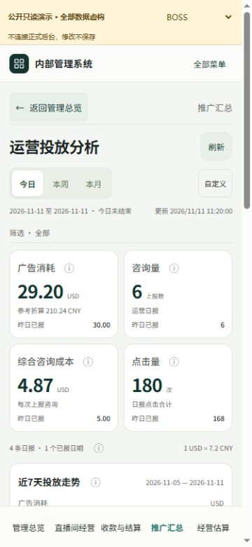

# BOSS 运营投放分析：独立演示整改

2026-11-11 用户确认继续优化运营投放页，沿用仅独立演示站的范围。由 Codex 负责指标与界面，正式运营填报、财务流程、后端数据库及 Windows 安装副本不变。

## 页面问题与处理

问题：BOSS需要逐条阅读运营填报单，无法直接比较投入和咨询效果。

顺序：日期/筛选 → 广告消耗、咨询量、综合咨询成本、点击量 → 近7天趋势 → 按人设/主页、平台、广告账户分类对比 → 账户余额快照 → 原始日报折叠明细。

- 维持项目浅色深绿主题。金额用数字；时间变化用带断点、今日虚线的趋势；分类用可排序对比表（手机折为同列字段卡片）；共享账户余额另列，不和消耗并加。
- 所有指标带ⓘ定义和来源。关注异常来自已有数据事实（有消耗无咨询、缺字段、余额冲突），不擅设业务考核阈值或自动给加减预算结论。
- 日、周、月及自定义日期与三个维度筛选作用于汇总、表格、日报；趋势明确是截至结束日的近7天，不伪装成整月曲线。

## 统一计算契约

`GET /api/demo/ops-analysis`：只读静态演示拦截器，BOSS可读，写请求与其他角色拒绝。纯指标模块 `demo/ops-analysis-metrics.js` 同时供浏览器与Node测试使用，复用P0的日期和汇率整数工具。

请求：`preset=day|week|month`，或完整ISO `from`/`to`；`dimension=persona|platform|account`；可选 `persona`/`platform`/`account`，空值为全部，`__unassigned__`为未关联。日期无效或未来日期拒绝。

返回：`summary`、`comparison`、`trend.days`、`groups`、`records`、`balances.accounts`、`fx`、`definitions`。单位USD；参考CNY另列且注明汇率和生效日。输入均为同一组虚构运营日报。

- 综合咨询成本＝总消耗÷总咨询量。不可平均手填的每次咨询成本，不自动改写原报表。
- 咨询量保留运营上报语义，不等于去重客户人数或客服加粉。点击率没有曝光量不能重新汇总。
- 空范围/缺字段为未知，明确填0有效；零咨询成本为“—”，不显示无限大。分组缺字段也不按部分已知值排名。
- 没有小时级数据时，基准标“昨日已报/上周同期已报/上月同期已报”，只列历史基准值，不计算貌似同一时刻的增长率。
- 余额每账户取截至结束日最近快照，使用全账户记录，不能跨人设或日期相加。同一时刻不一致快照标冲突，不任取一条。
- 无法识别币种的历史推广费只保留原始字段，不进入USD或参考CNY合计。

## 已知对账与样例

丰富独立演示的4个人设、2个平台、2个共享账户及近7天数据，默认今日仍保持与P0相同的总消耗：

| 人设 | 平台 | 广告户 | 今日消耗USD | 咨询量 | 点击量 |
| --- | --- | --- | --- | --- | --- |
| 演示主页 A | Facebook | DEMO-ADS-01 | 12.20 | 3 | 75 |
| 演示主页 B | Facebook | DEMO-ADS-01 | 10.00 | 2 | 55 |
| 演示主页 C | TikTok | DEMO-ADS-02 | 7.00 | 1 | 50 |
| 演示主页 D | TikTok | DEMO-ADS-02 | 0.00 | 0 | 0 |

合计29.20 USD；6条上报咨询；180点击；综合咨询成本4.87 USD/咨询；参考汇率7.2时210.24 CNY。账户余额分别100.80及20.00 USD，合计120.80，只累计一次。第4天故意缺报，趋势断开，不当0；历史另有有消耗无咨询的样例。

历史投放样例补齐后，P0历史日期/周/月的广告消耗与净贡献随同一数据源更新；P0默认今日五项总数不变。P0文档中的旧历史截图为当时数据快照，以本次API返回为准。

## 构建与验收

仅Vite `demo` 模式启用BOSS分析界面；标准production模式保持原运营填报页。复用现有独立演示打包命令，补入静态指标脚本；发布ZIP使用正斜杠资源路径。

验收包括已知总额、同账户重复余额、筛选与排序、零咨询、缺字段/缺汇率、过期快照冲突、日期边界、角色及写入隔离；实际查看375/1440/3440三种宽度，保存截图后独立提交。

### 验收记录（2026-11-11）

- 指标与只读演示36项、前端回归69项，共105项测试通过。演示及标准production构建通过；production仍输出原`index-CycT6mU3.js`，未启用新投放页。
- 375×812首屏完整显示4项核心指标，KPI底部约641px，底部导航751px起；1440及3440宽度均无横向溢出。
- 实际核对今日29.20 USD／6／4.87 USD／180；Facebook筛选22.20 USD／5／4.44 USD／130，账户余额100.80 USD。
- 月视图215.20 USD／40／5.38 USD／1056，24条日报。成本升序为主页A（4.40）、D（5.00）、B（5.58）、C（8.17）。平台和广告账户两个维度切换均与同源数据一致。
- 无匹配日报显示“—”与空状态；明确零消耗保留0.00，零咨询不显示成本，趋势说明区分“未报”和“零咨询未计算”。手机ⓘ、原上报4.10、分类计算4.07、分类查看日报及返回路径均核验。
- 真实账号/主页资料待用户提供，用于后续正式资料映射；公开演示使用虚构名称与账号，不导入真实账户资料。

发布结果：演示页 `https://demo.nanzhaoarts.com/?role=boss&page=ops` 已更新至Cloudflare静态部署`0b89de9e`（100%就绪），11份公开资源HTTP200及SHA256均与验收包一致；另含`_headers`配置。线上375px再次核验29.20 USD／6／4.87 USD／180，原始日报默认折叠，无横向溢出。发布包中不包含用户随后提供的三个真实主页资料；资料独立记录在`docs/PERSONA_PAGE_DIRECTORY.md`，不进入演示包。
