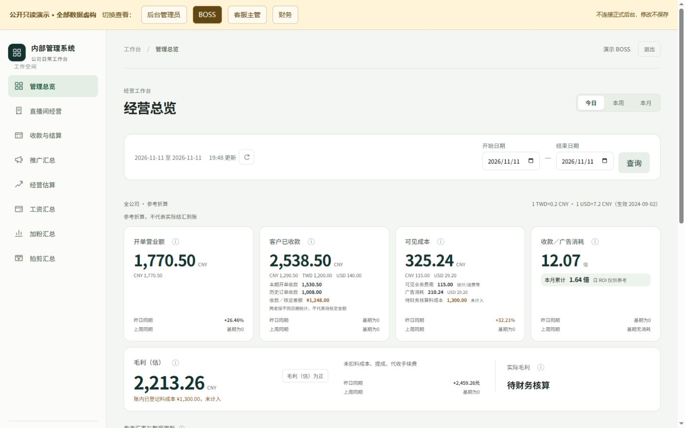
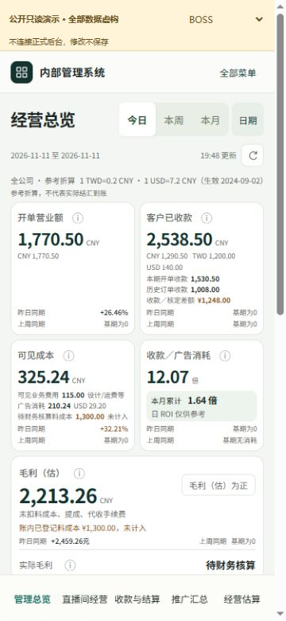
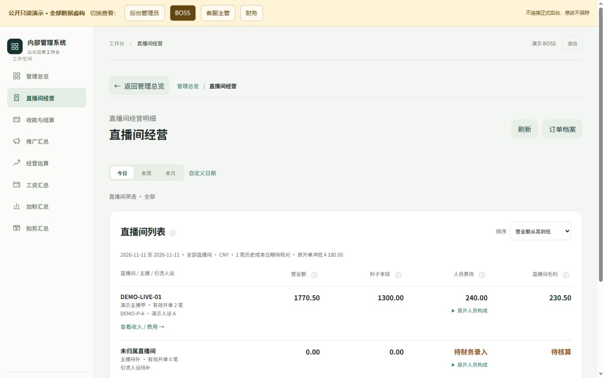

# PR #8 独立演示更新记录

发布时间：2026-11-11 19:48（UTC+8）。

本轮按用户授权同步新增需求到源码和独立演示站；Windows 已安装后台暂不更新。

## 版本与范围

- PR：<https://github.com/vane1202/company-management-system/pull/8>，已合并。
- 验收源码：`db940f0b7948aa0b473db07f963ae30a50a43239`；主分支合并提交：`aae617d4f99396f0021a8c164784e02d03d3af64`。
- 独立站：<https://demo.nanzhaoarts.com/?role=boss>。
- Cloudflare 项目 `cuiguanjia-preview`，部署版本 `959781ee`，100% 就绪；前版 `0b89de9e` 保留在部署历史中。
- 发布包为 12 个静态文件，仅含虚构演示数据；11 个公开资源均 HTTP 200、SHA256 与验收包一致，另一个文件为 `_headers`。
- 未连接业务数据库、未运行迁移 013、未复制安装目录、未重启 Windows 本地后台。

## 本轮交付

1. 经营总览补充收款来源、成本构成、料成本排除提示、参考汇率及生效日、本月累计 ROI 和基期为 0 的解释；毛利用语统一为「毛利（估）」「实际毛利」，保留口径说明。视频拍剪区下移、默认折叠。
2. 直播间列表展示营业额、料子本钱、人员费用、直播间毛利；提成由财务登记，不推算比例，缺值提示待核算。开单卡料本优先，缺省才回退供货款／配货款；跑单源单料本排除。按主播、人设、客服筛选时不将整间人员费用分摊给部分订单。
3. 演示订单档案展示料子本钱和料号，增加不保存的试填入口。原石代购费默认 10%，手动改后锁定，可恢复自动计算；成品始终为 0。修正了原提交中恢复按钮和切换成品未正确重置状态的问题。
4. 收款与财务核定按不同日期统计，差额仅说明两项数据的差异，不冒充待核定金额。公开站仍禁止业务写入。

## 验证

- 前端 72 项测试通过；演示指标和只读服务 40 项测试通过。
- `npm run build -w frontend -- --mode demo --outDir dist-demo`、`node scripts/package-role-demo.cjs --boss-p0`、标准 production 构建均通过。
- 浏览器检查 375×812、1440×900、3440×1440 无横向溢出，线上再次核对总览和直播间列表。手机较矮视口仍可能需要下滑查看毛利区。
- 实测代购费自动 10 → 手动 5 → 改价保留 5 → 恢复后随改价自动 30 → 切换成品 0；试填无保存操作。
- 正式财务录入格式、逐日提成覆盖完整性与迁移仍待后续处理。本次 production 构建包含共用布局源码变动，但没有部署到本地安装副本。

相关契约见 [经营总览](BOSS_OVERVIEW_P0_CONTRACT.md) 与 [直播间毛利](LIVE_ROOM_PROFIT_REQUIREMENTS.md)。

## 线上截图

